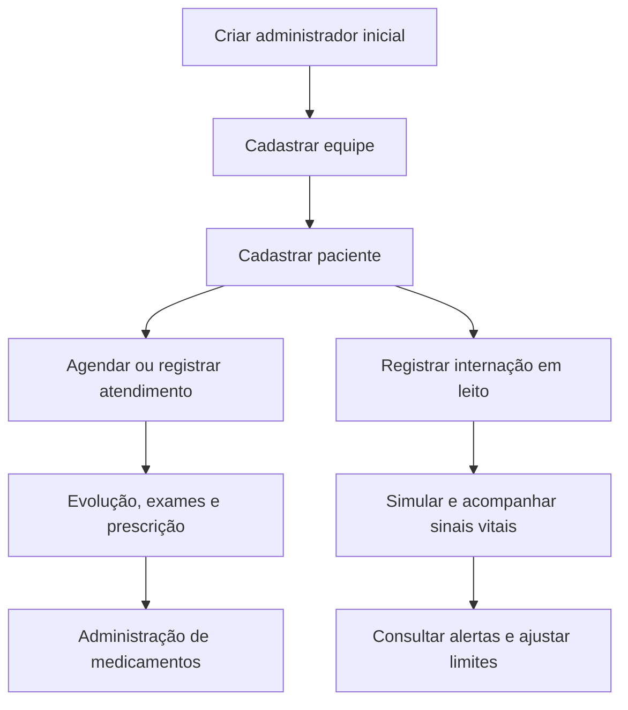

# Visão geral e funcionalidades

[← Índice](README.md) · [Próximo: arquitetura →](02-arquitetura.md)

## Objetivo

Concentrar informações do atendimento hospitalar e permitir que a equipe acompanhe pacientes internados em uma interface web. O projeto combina funcionalidades administrativas e assistenciais com um fluxo de monitoramento simulado de sinais vitais.

## Perfis de uso

| Perfil | Responsabilidade na interface |
| --- | --- |
| Administrador | Gerenciar profissionais, consultar atividades e configurar os limites gerais de sinais vitais |
| Médico | Consultar pacientes e internações, trabalhar com dados clínicos, prescrições, exames e monitoramento |
| Enfermagem | Acompanhar internados e sinais vitais, consultar prescrições e registrar a administração de medicamentos |
| Recepcionista | Trabalhar com cadastro de pacientes, agenda, leitos e internações |

A API usa os identificadores `ADMINISTRADOR`, `MEDICO`, `ENFERMEIRA` e `RECEPCIONISTA`. O código utiliza `ENFERMEIRA` mesmo quando o texto da interface se refere à enfermagem. As permissões efetivas de cada rota estão no [guia da API](04-api-e-permissoes.md); a presença de uma entidade no banco não significa que todo perfil tenha uma tela para editá-la.

## Módulos

| Módulo | Dados e operações principais |
| --- | --- |
| Acesso | Login por e-mail e senha, JWT e seleção de painel conforme o perfil |
| Equipe | Cadastro, edição e exclusão de profissionais, com campos como CRM ou COREN |
| Pacientes | Identificação, contato, prontuário, convênio e sexo |
| Agenda | Agendas médicas e agendamentos de pacientes |
| Estrutura hospitalar | Leitos, quarto, andar, setor, tipo e situação |
| Internação | Vínculo entre paciente e leito, datas de entrada, previsão de alta e alta |
| Atendimento | Registro do atendimento e profissionais responsáveis |
| Evolução clínica | Descrição, anamnese, exame físico, diagnóstico e conduta |
| Medicação | Medicamentos, prescrições, itens e registros de administração |
| Exames | Exames de imagem, laboratoriais, ECG e resultados |
| Monitoramento | Valores atuais, gráficos temporários, alertas e limites por paciente |
| Atividades | Registro de ações com identificação do profissional |

## Fluxo administrativo e assistencial

O diagrama representa a sequência de uso recomendada. As validações efetivas estão distribuídas entre interface, DTOs, serviços e restrições SQL. Não se deve presumir que todas as transições desse fluxo tenham uma máquina de estados própria no backend.

## Primeiro uso por perfil

**Administração:** entre com o usuário criado pelo endpoint de configuração inicial. Cadastre a equipe e verifique os perfis antes de distribuir os acessos. A configuração inicial é recusada quando já existe um administrador.

**Recepção:** localize ou cadastre o paciente, consulte os leitos e registre a internação quando aplicável. Para a simulação, a internação precisa ter `dataAlta` nula.

**Medicina:** consulte as informações do paciente e do atendimento. Os registros clínicos e as prescrições dependem de identificadores de entidades existentes. Abra o monitoramento para observar os sinais recebidos.

**Enfermagem:** consulte pacientes internados e prescrições. Registre a administração de medicamentos vinculada ao item prescrito e acompanhe os alertas de monitoramento.

## Navegação e sessão

A interface possui a rota `/login` e painéis sob `/painel`, com seções `administrador`, `medico`, `enfermagem` e `recepcao`. O painel permitido é calculado a partir do perfil devolvido pela API.

A sessão é armazenada em `sessionStorage`, na chave `inteliHosp-session`. O tema visual claro ou escuro é salvo em `localStorage`. A proteção de rotas no navegador complementa as verificações de autorização da API.

## Escopo confirmado e fronteiras

O código confirma cadastro e persistência de entidades hospitalares, autenticação e um fluxo de sinais em tempo real. A ingestão mantém apenas os valores atuais em memória. Os gráficos e o reconhecimento dos alertas de monitoramento têm estado no navegador. Não foi identificado neste fluxo um serviço de aquisição de sensores físicos, prontuário interoperável ou armazenamento histórico de séries temporais.
