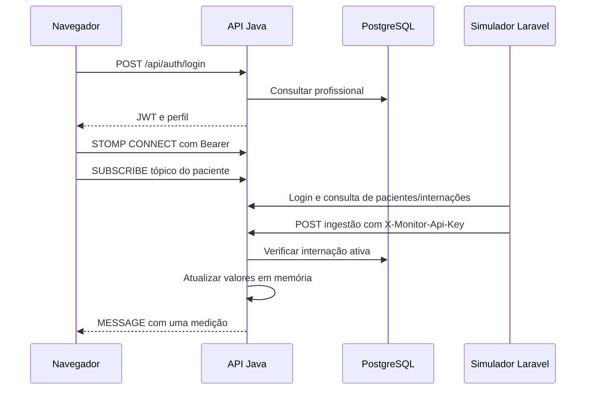

# Arquitetura e organização

[← Índice](README.md) · [Próximo: instalação →](03-instalacao.md)

## Componentes e tecnologias

| Camada | Tecnologias declaradas | Papel |
| --- | --- | --- |
| Interface | React 19, TypeScript 5.7, Vite 8, Tailwind CSS 4 | Painéis, formulários, gráficos e comunicação com a API |
| API | Java 21, Spring Boot 4.1.1, Spring MVC, Security, JPA, Validation | Regras, acesso a dados e autorização |
| Autenticação | JJWT 0.12.6 e BCrypt | Tokens assinados e hash de senhas |
| Tempo real | Spring WebSocket e STOMP | Distribuição de sinais por paciente |
| Banco | PostgreSQL 17 no Docker Compose | Dados hospitalares e configurações |
| Migrações | Flyway | Evolução versionada do esquema |
| Referência HTTP | springdoc OpenAPI 3.1.0 | Contrato acessível por Swagger UI |
| Simulação | PHP 8.2 ou superior, Laravel 12 | Geração e envio periódico de medições |

As versões acima vêm dos manifestos. Intervalos como `^19.0.0` permitem versões compatíveis; para uma instalação reprodutível, use os arquivos de lock do repositório original.

## Organização do repositório

```text
hospital_inteligente/
├── backend/
│   ├── README.md
│   ├── InsertData.md
│   └── hospital-api/
│       ├── pom.xml
│       └── src/
│           ├── main/java/br/com/unicesumar/hospital_api/
│           │   ├── config/
│           │   ├── controllers/
│           │   ├── dtos/
│           │   ├── exception/
│           │   ├── models/
│           │   ├── repositories/
│           │   ├── security/
│           │   └── services/
│           ├── main/resources/db/
│           └── test/java/
├── frontend/
│   ├── components/
│   ├── hooks/
│   ├── services/
│   ├── App.tsx
│   └── vite.config.ts
├── simulador-laravel/
│   ├── app/Services/
│   ├── app/Http/Controllers/
│   ├── app/Console/Commands/
│   ├── config/
│   └── routes/
├── docs/
├── docker-compose.yml
└── dev.sh
```

## Organização da API

A sequência usual é `controller → service → repository → PostgreSQL`. Os DTOs definem o contrato de entrada e saída. O tratamento centralizado de exceções produz respostas HTTP com `ProblemDetail`.

`AbstractDomainController` fornece listagem, consulta, criação, atualização e exclusão. A autorização combina as anotações dos controllers com `ApiAuthorization`. `AbstractDomainService` converte DTOs e entidades por `ObjectMapper`, utiliza transações e delega a persistência ao JPA. Atualizações genéricas usam `PUT` com o DTO completo; não equivalem a uma alteração parcial por `PATCH`.

Os serviços de autenticação, funcionários, dados de teste, limites, internações e sinais vitais acrescentam comportamento específico. `VinculosClinicos` verifica a coerência entre paciente, atendimento e item de prescrição nos serviços que o utilizam; essa validação de consistência não é uma política de acesso por vínculo assistencial. A ingestão de sinais utiliza `ConcurrentHashMap`, sem repository de medições nesse caminho.

## Organização da interface

`App.tsx` restaura a sessão e escolhe o painel. Os painéis médico, de enfermagem e de recepção são carregados sob demanda com `React.lazy`. Um componente de tratamento de erro permite tentar carregar o painel novamente.

`services/api.ts` concentra o cliente HTTP e os contratos TypeScript, com timeout de 12 segundos para evitar requisições indefinidamente pendentes. `services/mappers.ts` adapta representações da API. Os arquivos `*Store.ts` apoiam os fluxos dos painéis. `hooks/usePanelRoute.ts` controla navegação; `hooks/useVitalFeed.ts` consulta os valores atuais e mantém a conexão STOMP.

## Comunicação entre componentes



## Decisões com impacto operacional

- O Compose inicia somente o PostgreSQL. API, interface e simulador são processos separados.
- A porta padrão da interface é **8443 com HTTP**; esse número não habilita TLS.
- O broker STOMP é simples e está no processo da API; não há broker externo configurado.
- Reiniciar a API limpa os sinais atuais; reiniciar o banco com o volume preservado mantém os dados persistentes.
- O simulador grava seu estado em arquivo e consulta internações novamente a cada ciclo.
- As datas do backend usam configurações de `America/Sao_Paulo`. A ingestão usa `LocalDateTime`, sem deslocamento explícito no contrato.
