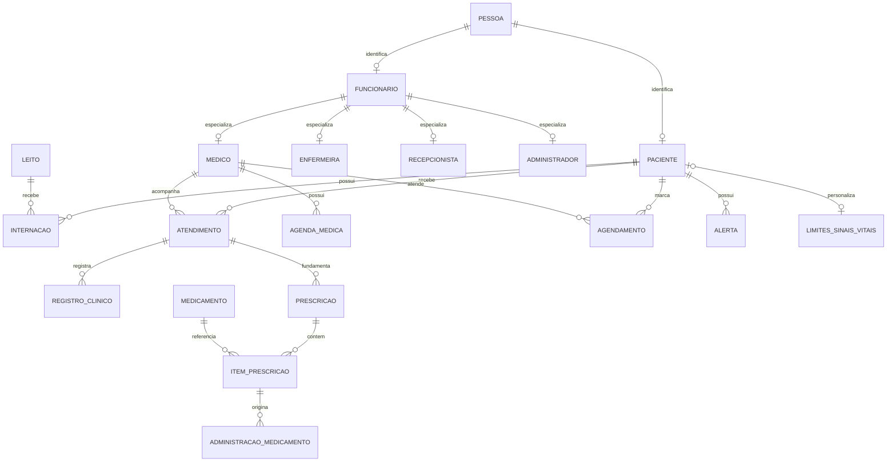

# Modelo de dados

[← Índice](README.md) · [Próximo: monitoramento →](06-monitoramento.md)

## Visão estrutural

O PostgreSQL armazena cadastros, dados assistenciais, atividades e limites de monitoramento. Pessoas e profissionais usam tabelas relacionadas por identificadores compartilhados. As entidades Java representam esses vínculos e o Flyway mantém a estrutura SQL.

O diagrama abaixo é uma síntese dos relacionamentos centrais, não uma reprodução de todas as colunas:

## Entidades por área

| Área | Entidades / tabelas | Conteúdo |
| --- | --- | --- |
| Identidade | Pessoa, Funcionario, Administrador, Medico, Enfermeira, Recepcionista, Paciente | Dados pessoais, credenciais e especializações |
| Agenda | AgendaMedica, Agendamento | Disponibilidade e marcação de atendimento |
| Hospitalização | Leito, Internacao | Estrutura física, vínculo e período de internação |
| Atendimento | Atendimento, FichaAtendimento, RegistroClinico | Responsáveis e informações clínicas |
| Medicação | Medicamento, Prescricao, ItemPrescricao, AdministracaoMedicamento | Catálogo, prescrição e execução |
| Exames | ExameImagem, ExameLaboratorial, ECG, ResultadoExame | Solicitações, informações técnicas e resultados |
| Monitoramento | Alerta, LimitesSinaisVitais | Alertas persistidos e parâmetros configuráveis |
| Atividades | RegistroAtividade | Ação, entidade, detalhes e profissional |

`Exame` também existe como abstração no modelo Java. Os sinais recebidos pela ingestão não são uma tabela histórica nesse esquema. O DTO WebSocket `SinalVital` representa uma mensagem, não um registro persistido pelo serviço de ingestão.

## Regras relevantes do banco

- Internações referenciam paciente e leito existentes.
- Índices únicos parciais impedem mais de uma internação sem alta para o mesmo paciente e para o mesmo leito.
- As datas de previsão de alta e alta, quando presentes, não podem preceder a internação.
- Itens referenciam prescrições e medicamentos; a exclusão da prescrição remove seus itens por `ON DELETE CASCADE`, sujeita aos demais vínculos existentes.
- A configuração global de limites tem `paciente_id` nulo. Um índice parcial permite apenas uma configuração global.
- Configurações individuais têm `paciente_id` preenchido e único. A exclusão do paciente remove seus limites por cascata.
- Os limites preservam o profissional responsável pela atualização quando existente; sua exclusão pode tornar esse vínculo nulo.

A definição de internação ativa usada tanto no simulador quanto na ingestão é **`data_alta IS NULL`**. O texto do campo `status` não substitui esse critério.

## Regras dos serviços de internação e vínculos clínicos

Na criação de uma internação ativa, o serviço bloqueia o leito para atualização e exige que seu status seja `Disponível` ou `Disponivel`, sem diferenciar maiúsculas e minúsculas. O leito passa a `Ocupado` na mesma transação.

Na alta, o leito volta a `Disponível`; não é permitido trocar de leito no mesmo pedido que registra a alta. Uma internação já encerrada não aceita atualização por esse serviço. A transferência de uma internação ativa bloqueia os dois leitos em ordem de identificador, ocupa o destino e libera a origem. Excluir uma internação ativa também libera seu leito. Os índices únicos do banco complementam essas regras.

`VinculosClinicos` recusa a associação de um atendimento existente a outro paciente em prescrições, exames e ECG nos serviços que usam essa validação. Para administração de medicamento, verifica se o item pertence a uma prescrição do paciente informado. Referências inexistentes continuam sujeitas às chaves estrangeiras. A validação de consistência desses vínculos não restringe, por si só, o acesso de um profissional aos pacientes sob sua responsabilidade.

## Migrações existentes

| Arquivo em `backend/hospital-api/src/main/resources/db` | Finalidade |
| --- | --- |
| `V1__schema_inicial.sql` | Estrutura inicial, relacionamentos e restrições |
| `V2__campos_complementares_paciente_leito.sql` | Campos complementares de paciente e leito |
| `V3__vincular_exames_ao_paciente.sql` | Vínculos de exames com paciente, médico e atendimento |
| `V4__registro_atividades.sql` | Registro de atividades |
| `V5__limites_sinais_vitais.sql` | Configuração global e individual dos limites; carga inicial do padrão |

Flyway está habilitado em `classpath:db`, com validação de migrações e limpeza desabilitada. O Hibernate usa `validate`, portanto não cria automaticamente colunas ausentes.

Ao alterar o esquema, acrescente uma nova migração versionada. Editar uma migração já aplicada pode gerar divergência de checksum. Avalie a mudança em uma base descartável antes de aplicá-la a uma base com dados importantes.

## O que persiste e o que é temporário

| Informação | Local | Efeito de reinício |
| --- | --- | --- |
| Cadastros e registros assistenciais | PostgreSQL | Permanecem se o volume do banco for preservado |
| Limites gerais e individuais | PostgreSQL | Permanecem |
| Atividades enviadas à API | PostgreSQL | Permanecem |
| Sinais atuais | Memória da API Java | São perdidos ao reiniciar a API |
| Histórico do gráfico | Estado React, até 720 amostras por paciente no hook | Não é um histórico durável |
| Reconhecimento de alertas de monitoramento | Estado do componente React | Não constitui reconhecimento global persistido |
| Estado do simulador | `storage/app/simulation-state.json` | Pode sobreviver ao reinício do processo |

A existência da tabela `alerta` não implica que toda ocorrência calculada no monitoramento seja gravada nela. O fluxo de ingestão analisado atualiza memória e publica mensagens STOMP.
