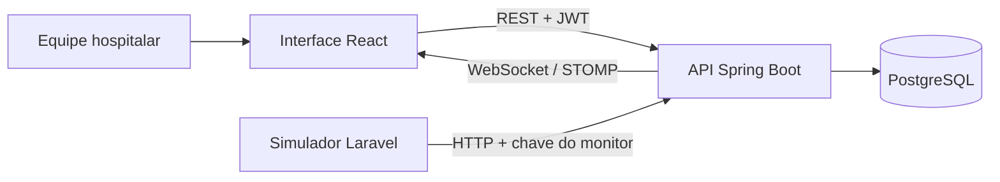

# Hospital Inteligente — documentação do projeto

> **Documentação técnica • 19 de novembro de 2026**  
> Base de análise: branch `main`, commit `89d8375aca013926e896e97ad51e675ee14ce84b`.  
> Referência técnica e funcional da implementação, com guias de uso, instalação e manutenção.

O **Hospital Inteligente** é uma plataforma web para organizar rotinas hospitalares e acompanhar sinais vitais de pacientes internados. O sistema reúne cadastro de pacientes e profissionais, agendamentos, internações, atendimento clínico, prescrições, exames e monitoramento com dados enviados por um simulador.

A aplicação apresenta painéis para administração, medicina, enfermagem e recepção. A interface usa a identificação **InteliHosp** em partes do código. A API centraliza os dados e o controle de acesso; o simulador produz medições e as envia à API; o navegador recebe atualizações por WebSocket.

## Navegue pela documentação

| Documento | O que você encontra |
| --- | --- |
| [Visão geral e funcionalidades](01-visao-geral.md) | Objetivo, perfis e fluxos de trabalho |
| [Arquitetura e organização](02-arquitetura.md) | Componentes, tecnologias e decisões da implementação |
| [Instalação e execução](03-instalacao.md) | Preparação do ambiente, primeiro acesso e inicialização |
| [API e controle de acesso](04-api-e-permissoes.md) | Rotas, autenticação, permissões e exemplos |
| [Modelo de dados](05-modelo-de-dados.md) | Entidades, relacionamentos, migrações e persistência |
| [Monitoramento e simulador](06-monitoramento.md) | Ingestão, WebSocket, limites e cenários |
| [Operação e manutenção](07-operacao.md) | Diagnóstico, verificações e limites conhecidos |
| [QA do backend e demonstração](qa/README.md) | Suítes, cenários e execução em ambiente isolado |
| [Relatório de testes](RELATORIO_TESTES.md) | Evidências e resultados registrados pela equipe |
| [Referências da análise](08-referencias.md) | Fontes, cobertura e critérios de manutenção |

**Para executar:** siga o guia de instalação e conclua o primeiro acesso antes de ativar a simulação.  
**Para desenvolver:** comece pela arquitetura, depois consulte a API e o modelo de dados.  
**Para apresentar:** use a visão geral e o roteiro de demonstração descrito abaixo.

## O sistema em um olhar

## Roteiro de demonstração

1. Inicie o banco e a API; crie o primeiro administrador.
2. Entre no painel administrativo e cadastre os profissionais necessários.
3. Cadastre um paciente e um leito; registre uma internação ativa.
4. Configure as credenciais do simulador e inicie o scheduler.
5. Abra o monitoramento em um painel médico ou de enfermagem.
6. Execute um cenário, por exemplo `febre`, e acompanhe os valores e alertas.
7. Demonstre os limites individuais e a restauração do padrão.

O fluxo de sinais analisado é simulado. O histórico de medições não é armazenado no PostgreSQL pela ingestão atual. Os limites numéricos documentados representam a configuração do software e não constituem orientação clínica.

## Materiais anteriores

A pasta `docs` já contém diagramas, identidade visual, documentos de visão, personas e registros de sprint. Este conjunto acrescenta uma documentação técnica navegável e preserva esses materiais. A lista dos arquivos existentes está em [Referências](08-referencias.md).
